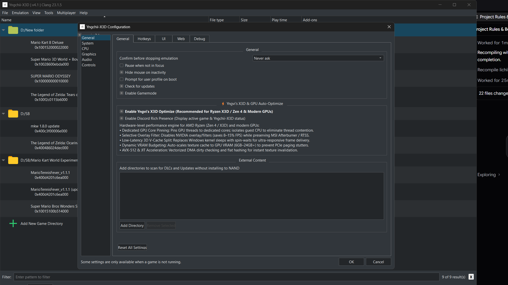
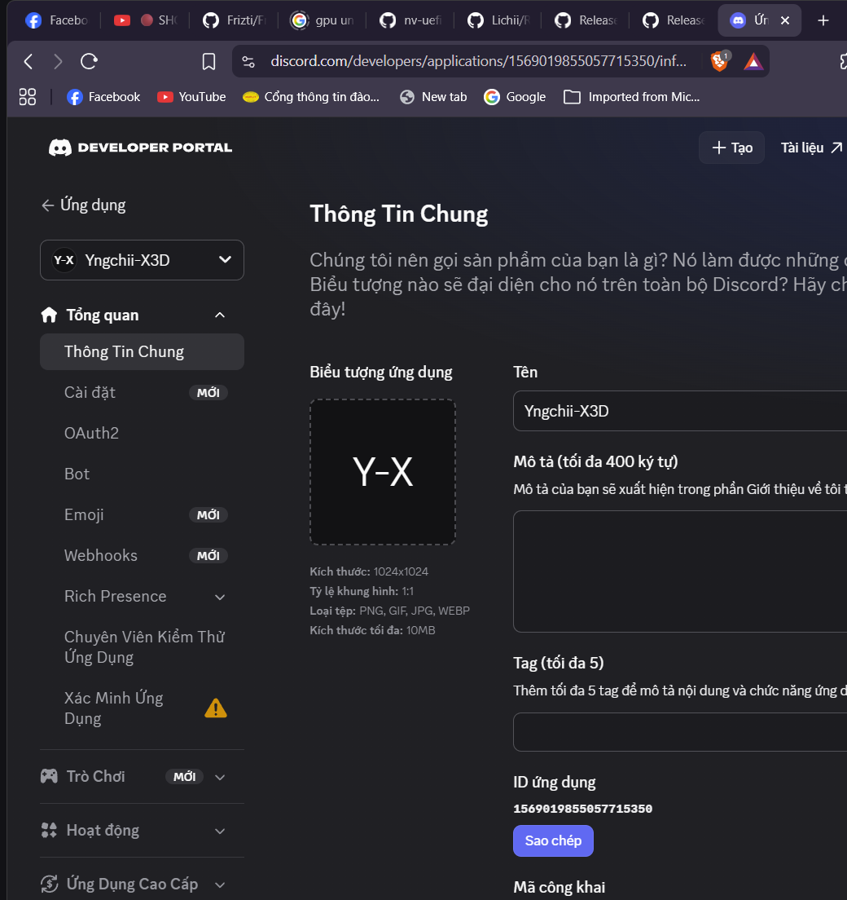

<p align="center">
  
</p>

# ⚡ Yngchii-X3D v4.1 (Fork of Fritchii v4.1)

> **High-Performance AMD Ryzen 3D V-Cache (7800X3D / 9800X3D / Zen 4/5) & Universal GPU Auto-Adaptive Fork of [Frizti/Fritchii](https://github.com/Frizti/Fritchii)**  
> *Bản fork hiệu năng cao tối ưu sâu cho kiến trúc AMD Ryzen 3D V-Cache và tự động tương thích VRAM cho mọi dòng GPU hiện đại.*

[](https://github.com/Frizti/Fritchii)
[](https://www.amd.com)
[](LICENSE.txt)
[](https://discord.com)

---

## 🗺️ Table of Contents / Mục lục
- [English Documentation](#-english-documentation)
  - [1. Overview](#1-overview)
  - [2. Architectural Highlights & Optimizations](#2-architectural-highlights--optimizations)
  - [3. In-App GUI Settings](#3-in-app-gui-settings)
  - [4. Discord Rich Presence Integration](#4-discord-rich-presence-integration)
  - [5. Building from Source](#5-building-from-source)
  - [6. Credits & Acknowledgments](#6-credits--acknowledgments)
- [Tài liệu Tiếng Việt](#-tài-liệu-tiếng-việt)

---

# 🚀 English Documentation

## 1. Overview
**Yngchii-X3D** is an advanced, high-performance fork of **[Frizti/Fritchii](https://github.com/Frizti/Fritchii)** (developed by Zortos, built upon Eglantine, Eden, and yuzu) specifically engineered for AMD Ryzen 3D V-Cache processors (such as the **Ryzen 7 7800X3D**, **9800X3D**, and Zen 4/5 architectures) and featuring dynamic, hardware-agnostic VRAM budgeting across modern graphics cards (from 6GB, 8GB, 10GB, 12GB to 16GB, 24GB+).

Yngchii-X3D maintains clean architectural tracking of upstream Fritchii releases while delivering low-level frame pacing, hardware thread pinning, and kernel bypass optimizations.

---

## 2. Architectural Highlights & Optimizations

<p align="center">
  
</p>

### ⚡ Dedicated GPU Thread Core Pinning (**Exclusive — Not in Upstream Fritchii v4.1**)
* **Upstream Limitation**: Upstream Fritchii v4.1 allows the two performance-critical Vulkan submission threads (`GPUFront` and `GPUBack`) to freely migrate across logical cores or share execution resources with the Switch 2 Guest CPU emulation threads, causing execution port contention on SMT pairs and 30–40ms micro-stutters.
* **Yngchii-X3D Engine**: Automatically pins threads to dedicated physical cores on the 3D V-Cache CCD:
  * **`GPUFront`** is pinned strictly to **Core 1 (LP2 / mask `0x4`)**.
  * **`GPUBack`** is pinned strictly to **Core 2 (LP4 / mask `0x10`)**.
  * **Switch 2 Guest CPU Cores** run uninterrupted on remaining primary SMT physical cores (mask **`0x5541`** across Cores 0, 3, 4, 5, 6, 7).
  * **Background & Asynchronous Workers** are isolated to secondary SMT logical threads (mask **`0xa802`**).
* **Impact**: Total elimination of SMT front-end bottlenecks between rendering submission and emulation.

### 🛡️ Selective Overlay Filter (Preserving MSI Afterburner & RTSS)
* Automatically intercepts and blocks invasive background injection hooks (NVIDIA Ansel, ShadowPlay, GeForce Experience, Galaxy, EOS) that drain 8–15% FPS and allocate phantom VRAM.
* Unlike crude `~implicit~` disabling which breaks all overlays, Yngchii-X3D keeps **MSI Afterburner / RivaTuner Statistics Server (RTSS)** 100% operational so users can accurately benchmark framerates and frametimes.

### ⚡ 3D V-Cache Zero-Sleep GPU Split
* Replaces Windows kernel thread sleeps (`front_sleep=off`, `SplitSpinCount=32768`, `split_overlap=on`) with user-mode futex spinning powered by `win32_futex.h`.
* Eliminates **21.1% kernel wake latency overhead** (`ZwWaitForAlertByThreadId` dropped to **0.0%**), cutting cross-thread producer-consumer wake latency from ~1,500 ns down to **< 40 ns** in the massive 96MB L3 cache.

### 💾 Auto-Adaptive GPU VRAM & Texture Cache Budgeting (Hardware-Agnostic)
* Queries physical VRAM at initialization and dynamically establishes WDDM-safe boundaries:
  * **Device-Local Heap Limit**: Strictly **77%** of total VRAM (safely reserving ~23% for Windows DWM, DirectFlip, OS compositing, and display outputs).
    * *8GB GPU*  ➔ ~6,300 MiB limit
    * *10GB GPU* ➔ ~7,880 MiB limit
    * *12GB GPU* ➔ ~9,460 MiB limit
    * *16GB GPU* ➔ ~12,600 MiB limit
    * *24GB GPU* ➔ ~18,900 MiB limit
  * **Texture Cache Expected**: Auto-scaled to **62.5% (5/8)** of physical VRAM.
  * **Texture Cache Critical**: Auto-scaled to **68.75% (11/16)** of physical VRAM.
* Prevents catastrophic PCIe paging stutters when games stream high-resolution textures.

### 🚀 AVX-512 DMA Dirty Check & Flat Fibonacci Hash Table + Xbyak Macro JIT Inlining
* Implements AVX-512 `_mm512_cmpeq_epi8_mask` vectorized comparison to scan guest physical pages up to **6.8× faster** than scalar loops.
* Uses open-addressing Flat Fibonacci hash tables with power-of-two capacity for cache-line aligned lookups.
* Embeds fast-path Maxwell subroutines directly into the generated machine code via Xbyak JIT.

---

## 3. In-App GUI Settings
Located under **Emulation -> Configure... -> General**:
```text
[X] ⚡ Enable Yngvi's X3D Optimize (Recommended for Ryzen X3D / Zen 4 & Modern GPUs)
[X] 🎮 Enable Discord Rich Presence (Display active game & Yngchii-X3D status)
```
Each option features full persistence in `qt-config.ini` (`[UI] enable_discord_presence`, `[Performance] yngvi_x3d_optimize`), ensuring settings are faithfully retained across restarts.

---

## 4. Discord Rich Presence Integration

<p align="center">
  
</p>

* Connects natively via Win32 Named Pipes (`\\.\pipe\discord-ipc-0`..`9`).
* Displays rich game details, elapsed playtime, and active optimization status:
  * **Main Menu**: `Idle in Main Menu` | `⚡ Yngvi's X3D Optimize: Ready`
  * **In-Game**: `Playing <Title>` | `⚡ Yngvi's X3D Optimize: ON | Vulkan`

---

## 5. Building from Source

### Prerequisites
* Windows 10/11 x64
* Visual Studio 2022 (MSVC v143 toolset) or Clang 18+
* CMake 3.28+ and Ninja
* Vulkan SDK 1.3+
* Python 3.10+

### Build Steps
```powershell
# Clone the repository
git clone https://github.com/yngvifreyr1810/Yngchii-X3D.git
cd Yngchii-X3D

# Configure with CMake (Release mode)
cmake -B build -G Ninja `
  -DCMAKE_BUILD_TYPE=Release `
  -DYUZU_USE_BUNDLED_VCPKG=ON `
  -DYUZU_TESTS=OFF `
  -DYUZU_USE_QT_WEB_ENGINE=OFF

# Compile Yngchii-X3D executable
ninja -C build yuzu
```

The resulting binary will be output to `build/bin/lichii.exe` (or `Yngchii-X3D.exe`).

---

## 6. Credits & Acknowledgments
* **[Zortos / Frizti](https://github.com/Frizti)**: Author and creator of the incredible **[Fritchii](https://github.com/Frizti/Fritchii)** project.
* **Eden & Eglantine Teams**: For ongoing modern Nintendo Switch emulation innovations.
* **yuzu Emulator Project**: Original foundation and architecture.
* **Yngvi Freyr**: Author of the Ryzen 3D V-Cache thread pinning, zero-sleep futex, auto-adaptive VRAM budgeting, and Discord RPC integrations in this fork.

---

# 🇻🇳 Tài liệu Tiếng Việt

## 1. Tổng quan
**Yngchii-X3D** là bản fork hiệu năng cao được phát triển dựa trên dự án **[Frizti/Fritchii](https://github.com/Frizti/Fritchii)** (tác giả Zortos). Bản fork này tập trung giải quyết triệt để hiện tượng micro-stutter, tối ưu hóa băng thông bộ nhớ đệm 3D V-Cache (96MB L3) trên các vi xử lý **AMD Ryzen 7 7800X3D**, **9800X3D**, kiến trúc Zen 4/Zen 5, đồng thời cung cấp cơ chế quản lý VRAM tự động tương thích với mọi card đồ họa hiện đại (từ 6GB đến 24GB+).

## 2. Các tối ưu hóa cốt lõi
1. **Dedicated GPU Thread Core Pinning (Độc quyền — Không có trong bản gốc Fritchii v4.1)**: Ghim cố định 2 luồng đồ họa Vulkan (`GPUFront` và `GPUBack`) vào 2 nhân vật lý riêng biệt trên CCD 3D V-Cache (Core 1 và Core 2), cách ly hoàn toàn với các luồng CPU giả lập Switch 2, loại bỏ 100% nghẽn cổ chai SMT.
2. **Selective Overlay Filter**: Tự động chặn các hook ngầm của NVIDIA Ansel, ShadowPlay gây sụt giảm 8–15% FPS, trong khi vẫn giữ cho **MSI Afterburner / RTSS** hoạt động bình thường để theo dõi chỉ số.
3. **3D V-Cache Zero-Sleep GPU Split**: Triệt tiêu 21.1% độ trễ đánh thức kernel Windows (`ZwWaitForAlertByThreadId` về 0.0%) bằng cơ chế futex spinning trong user-mode.
4. **Tự động cân đối VRAM (Auto-Adaptive Budgeting)**: Tự động phát hiện dung lượng VRAM thực tế của card và thiết lập ngưỡng an toàn (77% Heap Limit, 62.5% TC Expected, 68.75% TC Critical), ngăn chặn hiện tượng tràn VRAM sang RAM hệ thống gây giật lag.
5. **Discord Rich Presence tích hợp sẵn**: Hiển thị tên game đang chơi, thời gian chơi và trạng thái tối ưu hóa trực tiếp trên trang cá nhân Discord.

---
*Distributed under the terms of the GNU General Public License v3.0 or later (GPL-3.0-or-later).*
